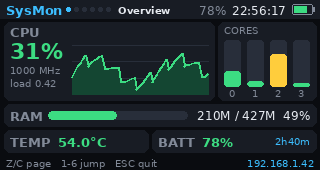
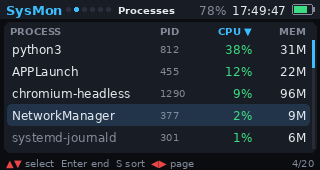
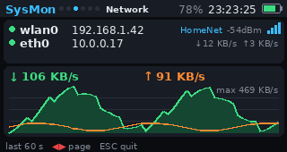
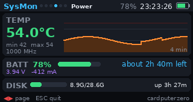
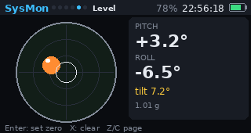
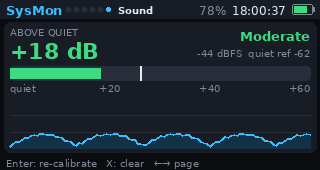

# SysMon for CardputerZero

A six-page system monitor for the M5Stack CardputerZero's 320×170 screen.

 
 
 

**Download:** get the latest `.deb` from the [Releases page](https://github.com/duanesweazy1/pocket-sysmon/releases).

| # | Page | Shows |
|---|---|---|
| 1 | Overview | CPU % with a 60-second graph, per-core bars, RAM, temperature, battery and time left |
| 2 | Processes | The top 20 programs by CPU or memory in a scrolling list; end one from the keyboard |
| 3 | Network | Interfaces and IPs, Wi-Fi name and signal, live download/upload speed graph |
| 4 | Power | 4-minute temperature graph, battery "time left" / "full in", voltage/current, disk, uptime |
| 5 | Level | Bubble level with pitch, roll and tilt, from the built-in motion sensor (not on the Lite model) |
| 6 | Sound | Live microphone loudness meter with peak hold and a 10-second history |

## Keys

| Key | Action |
|---|---|
| ◀ ▶ (the Z / C keys) or Tab | Previous / next page |
| 1 – 6 | Jump to a page |
| ESC or Q | Quit (or cancel a prompt) |
| **Processes:** ▲ ▼ (the F / X keys) | Scroll through the list and select a program |
| **Processes:** Enter or K, then Y | End the selected program |
| **Processes:** S | Sort by CPU or memory |
| **Level:** Enter | Use the current angle as zero (calibrate on a surface you know is flat) |
| **Level:** X | Clear the zero |
| **Sound:** Enter | Calibrate: press in a quiet room to save that as "quiet" (kept between runs) |
| **Sound:** X | Clear the sound calibration |

Ending a process sends it a normal "please stop" signal (SIGTERM). System programs (owned by root or another user) are shown in gray. SysMon deliberately doesn't have admin rights, so it can't end those; if you really need to, connect over SSH and run `sudo kill <PID>` using the PID shown in the list. The Sound page uses the microphone only while that page is open, and doesn't record anything. It ignores low-frequency hum (below 150 Hz). Once calibrated it shows how many dB the room is above your quiet reference. Readings are relative, not a certified sound-level (dB SPL) measurement.

## Install / update

Download the `.deb` from [Releases](https://github.com/duanesweazy1/pocket-sysmon/releases). Then, from PowerShell (Windows) or a terminal on your PC (use your Cardputer username and the IP shown in its **IP Panel** app):

```
scp pocket-sysmon_1.1.5-rev1_arm64.deb YOURUSER@DEVICE-IP:/tmp/
ssh YOURUSER@DEVICE-IP
sudo apt install /tmp/pocket-sysmon_1.1.5-rev1_arm64.deb
sudo reboot
```

Installing over 1.0.0 upgrades it in place. The device needs internet access during install in case a microphone tool (`pipewire-bin`, normally already installed) has to be downloaded. The reboot applies the screen, keyboard and audio permissions.

## Run or test by hand (over SSH)

```
python3 /usr/share/APPLaunch/apps/pocket-sysmon/sysmon.py
```

## Preview on a computer

Needs Python 3 and Pillow:

```
python3 sysmon.py --preview page1.png 0 --mock     # pages are numbered 0-5 here
```

## Rebuild the .deb

On Linux or WSL, from a clone of `CardputerZero/AppBuilder`:

```
chmod +x /path/to/sysmon/packaging/*.sh /path/to/sysmon/packaging/postinst
scripts/pack-deb.sh /path/to/sysmon --output-dir dist
```

## Publish to the Store

With a clone of `CardputerZero/AppBuilder`, run `czdev login`, then `czdev publish --deb pocket-sysmon_<version>-rev1_arm64.deb` from this folder. The first release needs a short video of the app running on a real device, posted on the pull request.

License: MIT. See [LICENSE](LICENSE).
